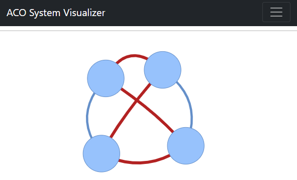
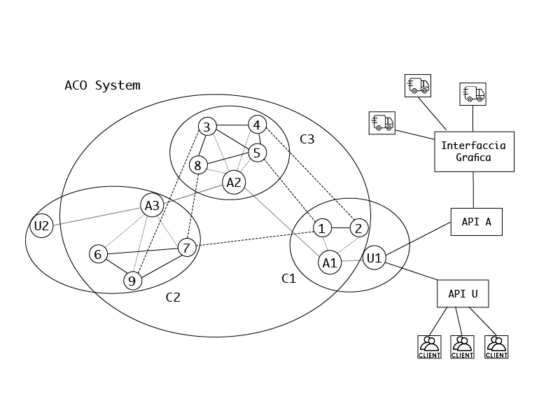

# Distributed Systems – Ant Colony Optimization

Progetto del corso di Sistemi Distribuiti (DMIF, Università di Udine).
È un sistema distribuito peer-to-peer in Erlang/OTP che approssima il **problema del commesso viaggiatore (TSP)** su un grafo di clienti con una variante **asincrona e distribuita** dell'algoritmo *Ant Colony Optimization* ([Ilie & Badica, 2013](Papers/multi-agent-aco.pdf)).
Il percorso migliore trovato si visualizza in tempo reale da un'interfaccia web in Flask.

Autori: Daniele Ferroli, Luca Gemolotto.

La relazione completa è in [`Relazione/report.pdf`](Relazione/report.pdf) (sorgenti LaTeX nella stessa cartella).



## Funzionalità

- Calcolo continuo di un'approssimazione del ciclo hamiltoniano di costo minimo su un grafo completo, pesato e non orientato.
- Aggiunta e rimozione di clienti, anche mentre l'algoritmo è in esecuzione.
- Aggiornamento dei costi di spostamento tra clienti.
- Aggiunta e rimozione di uffici (cluster) e di nodi ACO a runtime.
- Tolleranza ai guasti: se un nodo ACO cade, i nodi rimanenti eliminano i clienti e gli archi irraggiungibili e rigenerano le formiche perse.
- Visualizzazione web del grafo con il percorso migliore evidenziato in rosso.

Trasparenze implementate: *access*, *location*, *concurrency*, *scaling* e *failure*.
Rispetto al teorema CAP il sistema privilegia **availability** e **partition tolerance**.

## Architettura

Il sistema è composto da due tipi di nodi Erlang distribuiti:

- **nodo ACO**: gestisce un sottoinsieme dei clienti (un ufficio) e partecipa al calcolo scambiando formiche con gli altri nodi;
- **nodo utente**: espone le API per gestire i clienti e scrive i dati per la GUI.

Più nodi possono girare sulla stessa macchina. La connessione transitiva fra i nodi è gestita da Erlang, perciò non serve un algoritmo di routing.



### Moduli (`erlang/`)

| File | Ruolo |
|---|---|
| `aco_node.erl` | `gen_server` principale: stato del nodo, inizializzazione via echo, ricezione e inoltro delle formiche, gestione delle modifiche al grafo con ticket, fault tolerance |
| `ant_colony.erl` | Logica ACO pura: scelta probabilistica dell'arco, generazione e aggiornamento delle formiche, deposito ed evaporazione dei feromoni |
| `aco_node_constants.hrl` | Parametri dell'algoritmo |
| `ticket_system_server.erl` | `gen_server` per l'elezione del *ticket master* (echo with extinction) e il rilascio dei ticket |
| `ticket_system.erl` | API del ticket system: elezione, richiesta di ticket, connessione a un sistema già avviato, rielezione se il master non risponde |
| `user_node.erl` | `gen_server` intermediario fra le API utente e i nodi ACO; tiene la mappa ufficio → nodo |
| `user_api.erl` | API pubbliche per il setup e l'interazione con il sistema |
| `flooding.erl` | Scrive il grafo (`graph.xml`) e i percorsi delle formiche (`path.xml`) in XML con `xmerl` |
| `ant_colony_SUITE.erl` | Test Common Test distribuiti, basati su `peer` |

### Algoritmi principali

- **ACO asincrono**: ogni nodo ACO genera *n* formiche per ciascun cliente locale. Una formica in `i` sceglie il nodo `j` con probabilità
  `p(i,j) ∝ τ(i,j)^α · η(i,j)^β`, dove `η` è l'inverso del peso dell'arco.
  Ad ogni passo si applica l'evaporazione locale `τ = (1-ξ)τ + ξτ₀`.
  A tour completato la formica ripercorre il cammino a ritroso depositando `Δτ = 1/C` con `τ = (1-ρ)τ + ρΔτ`, poi viene reinizializzata.
- **Inizializzazione via echo**: i nodi ACO si scambiano i rispettivi clienti locali prima di far partire le formiche.
- **Ticket system**: tutte le modifiche al grafo sono ordinate da un ticket rilasciato dal *ticket master*. Un nodo ACO applica la richiesta *n* solo dopo aver applicato tutte quelle precedenti.
- **Watchdog delle formiche**: per ogni formica inviata parte un timer di 30 s. Se il contatore arriva a zero, il nodo rigenera le formiche, così da recuperare quelle perse per crash o messaggi persi.

Parametri usati (`aco_node_constants.hrl`):

| α | β | τ₀ | ρ | ξ | `WORST_COST` |
|---|---|---|---|---|---|
| 1.0 | 5 | 1/2990 | 0.1 | 0.1 | 10⁹ |

### Interfaccia grafica (`WebInterface/`)

Webapp Flask (`app.py`) con frontend Bootstrap. `backend.py` legge `erlang/graph.xml` ed `erlang/path.xml` e costruisce il grafo con [PyVis](https://pyvis.readthedocs.io/). Il percorso migliore viene evidenziato in rosso e il costo compare passando il cursore sul percorso. La pagina si aggiorna da sola ogni 30 secondi.

## Requisiti

- Erlang/OTP **≥ 25** (i test usano il modulo `peer`)
- Python **≥ 3.5** con Flask e PyVis:

```sh
pip install flask pyvis
```

## Compilazione

```sh
cd erlang
erl -make
```

L'interfaccia Python non va compilata.

## Esecuzione

> I nodi Erlang vanno avviati **dalla cartella `erlang/`**: il processo `flooding` scrive `graph.xml` e `path.xml` nella directory corrente, e la GUI li legge da lì.
> Su ogni macchina può esserci un solo processo `flooding`, altrimenti più processi scriverebbero sugli stessi file.

### 1. Avviare la GUI

```sh
cd WebInterface
flask --app app run
```

L'interfaccia è disponibile su <http://127.0.0.1:5000>.

### 2. Avviare i nodi Erlang

In due terminali distinti, entrambi in `erlang/`:

```sh
erl -sname Utente
erl -sname Utente2
```

### 3. Setup del sistema

```erlang
%% Sul nodo che ospita il nodo utente (es. Utente):
user_api:system_setup().          % avvia user_node, ticket_system_server, flooding, aco_node

%% Sugli altri nodi (es. Utente2):
user_api:system_setup_simple().   % avvia solo aco_node e ticket_system_server

%% Collegare i nodi, ad esempio da Utente:
net_adm:ping('Utente2@hostname').
```

### 4. Uffici, clienti e costi (dal nodo utente)

```erlang
user_api:add_office(milano, node()).
user_api:add_office(udine,  'Utente2@hostname').
user_api:add_office(padova, 'Utente2@hostname').

user_api:start_election().

user_api:init_add_clients([{[1,2], milano}, {[3], udine}, {[4], padova}]).
user_api:init_add_costs([{1,2,5}, {1,3,6}, {1,4,7}, {2,3,8}, {2,4,9}, {3,4,10}]).

user_api:system_start().
```

### 5. Interazione a runtime

```erlang
%% Aggiungere un cliente indicando i costi verso gli altri
user_api:add_client(5, udine, [{1,5,1}, {2,5,1}, {3,5,1}, {4,5,1}]).

%% Rimuovere un cliente
user_api:remove_client(5).

%% Aggiornare i costi degli archi
user_api:update_costs([{1,2,1}, {1,3,1}]).

%% Gestire gli uffici
user_api:add_office(OfficeID, Node).
user_api:remove_office(OfficeID).
```

#### Crash e reinserimento di un nodo ACO

Se si chiude il terminale di `Utente2`, entro circa 30 secondi il sistema rimuove i clienti e gli archi che quel nodo gestiva e continua a funzionare. Per reinserire il nodo:

```erlang
%% Su Utente, ricollegare il nodo:
net_adm:ping('Utente2@hostname').

%% Su Utente2:
user_api:system_setup_simple().
ticket_system:connect_to_system().
rr(aco_node).
aco_node:add_local_node(#node{name=3}).
aco_node:add_edges([#edge{from=#node{name=1}, to=#node{name=3}, weight=6},
                    #edge{from=#node{name=2}, to=#node{name=3}, weight=8}]).
aco_node:running_init(3).
```

## Test

I test usano **Common Test** e il modulo `peer` di OTP 25 per simulare più nodi distribuiti. I dataset si trovano in `erlang/ant_colony_SUITE_data/`.

1. In `erlang/ant_colony.spec` sostituire i percorsi assoluti (righe `include` e `alias`) con il percorso della propria cartella `erlang/`.
2. Scommentare la riga `cases` o `groups` da eseguire.
3. Eseguire:

```sh
cd erlang
ct_run -spec ant_colony.spec
```

Il report HTML viene generato in `erlang/ant_colony_logs/`.

| Gruppo | Test case |
|---|---|
| `basic` | `test_wi29`, `test_be52` |
| `bewi` | `test_be52`, `test_wi29` (50 ripetizioni) |
| `qa` | `test_qa194` |
| `graph_dyn` | `test_removal`, `test_update`, `test_addition`, `test_addition_removal` |
| `removal` | `test_aco_removal_wi29` |
| `fault_tolerance` | `test_aco_removal_wi29`, `test_peer_addition_wi29` |

### Benchmark sui dataset TSP

Sono stati usati i dataset TSP dell'[Università di Waterloo](https://www.math.uwaterloo.ca/tsp/world/countries.html). I file `.tsp` sono in `erlang/config/`. Lo script `erlang/config/gen_config.py` calcola le distanze euclidee e genera i file dei nodi e degli archi (il nome del dataset è scritto nello script).

Ogni test termina quando trova un percorso entro il **10%** dall'ottimo, oppure allo scadere del timeout.

| Dataset | Nodi | Ottimo | Ripetizioni / timeout | Risultato medio |
|---|---|---|---|---|
| Western Sahara (wi29) | 29 | 27603 | 50 / 1 min | 29856.10 (108.1%), sempre entro 1 s |
| Berlin52 | 52 | 7542 | 50 / 3 min | 8214.55 (108.9%), 8 timeout |
| Qatar (qa194) | 194 | 9352 | 18 / 10 min | 12531.93 (134%), soglia mai raggiunta |

## Limiti noti

- Il grafo è completo ed esplicito, quindi gli archi crescono come O(n²) e vanno sincronizzati su tutti i nodi ACO. Con 1000 clienti si arriva a circa 500 000 archi.
- La GUI fa il parsing dell'XML con `xml.dom.minidom`, vulnerabile a *Billion Laughs* e *quadratic blowup* nel caso in cui i file XML vengano manomessi.
- Nella spec i percorsi sono assoluti e vanno adattati a mano.
- `all/0` in `ant_colony_SUITE` comprende il gruppo `uy`, che fa riferimento a `test_uy734`, ma questo test non è implementato. Conviene quindi eseguire i gruppi tramite la spec.
- La cartella `erlang/ticket_system/` contiene una versione precedente del ticket system. L'`Emakefile` non la compila e quella in uso è quella in `erlang/`.

## Struttura del repository

```
├── erlang/            # Sistema ACO (Erlang/OTP) e test
│   ├── config/        # Dataset .tsp, configurazioni e script di conversione
│   └── ant_colony_SUITE_data/
├── WebInterface/      # GUI Flask + PyVis
├── Relazione/         # Relazione LaTeX, diagrammi e PDF
└── Papers/            # Articolo di riferimento sull'ACO multi-agente
```
